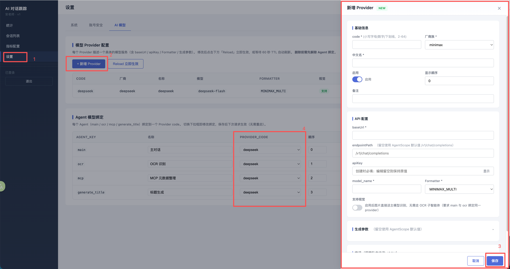
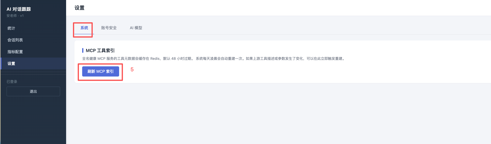

# qm_health 本地服务

用 Docker Compose 一键拉起 qm_health 项目本地开发所需的整套服务：

| 服务 | 镜像 | 容器名 | 默认端口 |
| --- | --- | --- | --- |
| PostgreSQL | `postgres:16.3` | `postgres16.3` | 5432 |
| Redis | `redis:8.6.0` | `redis8.6.0` | 6379 |
| qm-health-rust | `ghcr.io/zhouxingma/qm-health-rust:latest` | `qm-health-rust` | 8080 |
| qm-health-ai | `ghcr.io/zhouxingma/qm-health-ai:latest` | `qm-health-ai` | 8082 |

首次启动时会自动执行 `init-sql/` 下的建表脚本与基础数据，得到一个可直接使用的空库。

启动顺序由依赖关系决定：`postgres` / `redis` 通过健康检查 → `qm-health-rust` → `qm-health-ai`（ai 启动时要连 rust 拉 MCP 工具列表）。前端页面由 `qm-health-ai` 提供，访问 <http://localhost:8082/> 即可。

## 前置要求

- Docker Engine 20.10+
- Docker Compose v2（`docker compose` 子命令）

## 快速开始

1. 准备配置文件。`.env` 不入库，需要从模板复制：

   ```bash
   cp .env.example .env
   ```

   按需修改密码和端口，默认值即可直接运行。

2. 启动服务：

   ```bash
   docker compose up -d
   ```

3. 确认状态。`postgres` / `redis` 带 healthcheck，`STATUS` 显示 `healthy` 即表示数据服务就绪：

   ```bash
   docker compose ps
   ```

   两个应用没有 healthcheck（rust 镜像内没有 http 客户端，做不了），`Up` 即表示进程还活着。

4. 连接数据库验证：

   ```bash
   docker exec -it postgres16.3 psql -U postgres -d qm_health -c '\dt'
   ```

   应能看到 `users`、`sys_health_indicators` 等表。

5. 验证两个应用：

   ```bash
   curl -s -o /dev/null -w '%{http_code}\n' http://localhost:8080/
   ```

   ```bash
   curl -s -o /dev/null -w '%{http_code}\n' http://localhost:8082/
   ```

   都返回 `200` 即表示应用已连上数据库与 Redis 并开始对外服务。

6. 打开前端页面 <http://localhost:8082/login.html>（qm-health-ai 提供的静态页），用 `init-sql/02-seed.sql` 里的内置管理员 `admin` 登录。此时 AI 对话还不能用——需要先按下面「模型配置」一节配好模型 Provider 并完成 Agent 绑定。

> 若 `docker compose up` 报 `unauthorized`，说明拉不到 GHCR 上的镜像，先登录再重试：
>
> ```bash
> docker login ghcr.io
> ```
>
> 两个应用镜像都是 GHCR 上的包，其中任一被设为私有就需要这一步。

## 模型配置

AI 模型（`ai_model_provider` + `ai_agent_model`）在管理后台**「设置 → AI 模型」**页配置，保存即写库，**无需改代码或重启容器**。

后台页面由 `qm-health-ai` 提供，地址随 `.env` 里的 `AI_PORT`（默认 8082）：

<http://localhost:8082/settings.html>

用内置管理员 `admin` 登录后即进入该页。



1. 左侧菜单进入**「设置」**，切到**「AI 模型」**标签页。
2. 点**「+ 新增 Provider」**，在右侧表单填写模型服务信息后保存：
   - **基础信息**：`code`（小写字母/数字/下划线，2–64 位，创建后不可改）、厂商族（`minimax` / `deepseek` / `openai` / `glm`）、中文名、启用开关、显示顺序、备注。
   - **API 配置**：`baseUrl`、`endpointPath`（留空使用 AgentScope 默认值 `/v1/chat/completions`）、`apiKey`（创建必填；编辑留空则保持原值）、`model_name`、`Formatter`。
   - **生成参数**（均可留空使用默认值）：temperature / topP / topK / maxTokens / thinkingBudget / reasoningEffort / seed / frequencyPenalty / presencePenalty，以及扩展 body / header / query JSON。
   - **支持视觉**：开启后图片直接送主模型识别，无需 OCR 子智能体（要求 `main` 与 `ocr` 绑定同一 provider）。
3. 点**「保存」**。
4. 在下方**「Agent 模型绑定」**里，为 `main` / `ocr` / `mcp` / `generate_title` 各选一个 `PROVIDER_CODE`（切换后下一次请求即生效，无需重启）。
5. 若上游全名健康 MCP 服务的工具描述或参数发生变化，回到**「系统」**标签页点**「刷新 MCP 索引」**立即重建（默认缓存 48 小时，系统每天凌晨自动重建一次）。



> 初始化脚本 `02-seed.sql` 已预置四条 `ai_agent_model` 绑定记录，但 `provider_code` 故意留空，由 `ModelConfigBootstrap` 在启动时补齐——所以**首次启动后仍需按上面的步骤配置至少一个 Provider 并完成绑定**，否则 AI 对话无法调用模型。
>
> 修改 Provider 后如需立即生效，可点「AI 模型」页的**「Reload 立即生效」**强制刷新 `ModelProviderService` 缓存；否则 60 秒 TTL 到期后自动刷新。

## 版本匹配

三个服务需要配套使用，版本组合在下面维护。`.env` 里的 `RUST_VERSION` / `AI_VERSION` **填具体版本号，不要用 `latest`**——可变 tag 拉到的是哪一版不确定，出问题也无法按版本回退。

| 组件 | 对应变量 | 版本 | 状态 | 仓库地址 |
| --- | --- | --- | --- | --- |
| qm-health-rust | `RUST_VERSION` | `v0.0.6` | ✅ 最新 | 暂不开源 |
| qm-health-ai | `AI_VERSION` | `v0.0.6` | ✅ 最新 | 暂不开源 |
| qm-healthapp | — | `v1.2` | ✅ 最新 | <https://github.com/ZhouXingma/qm-health> |

对应配置：

```bash
# .env
RUST_VERSION=v0.0.6
AI_VERSION=v0.0.6
```

### 兼容性

| rust | ai | qm-healthapp | 状态 | 说明 |
| --- | --- | --- | --- | --- |
| `v0.0.6` | `v0.0.6` | `v1.2` | ✅ 最新 | 当前推荐组合 |
| `v0.0.5` | `v0.0.5` | `v1.1` | 历史版本 | 可回退 |
| `v0.0.4` | `v0.0.4` | `v1.0` | 历史版本 | 可回退 |

> 新版本发布时在上表追加一行，把上一行的状态改为「历史版本」保留下来，作为回退时的可选项——不要直接删行，否则失去回退依据。

前后端是强耦合的：前端页面由 `qm-health-ai` 提供，app 通过 `RUST_PUBLIC_URL` 下发的 `rustApiBase` 直接调 rust 的 `/admin/*` 接口（见下），所以三者的版本要一起升，不要只升其中一个。

升完之后注意 ai 不会自动重启——它手里的 MCP 工具索引可能还是旧的，需要单独重建：

```bash
docker compose up -d --force-recreate qm-health-ai
```

## 配置说明

所有可配置项都在 `.env`：

| 变量 | 默认值 | 说明 |
| --- | --- | --- |
| `POSTGRES_VERSION` | `16.3` | PostgreSQL 镜像 tag |
| `REDIS_VERSION` | `8.6.0` | Redis 镜像 tag |
| `RUST_VERSION` | `latest` | qm-health-rust 镜像 tag |
| `AI_VERSION` | `latest` | qm-health-ai 镜像 tag |
| `POSTGRES_USER` | `postgres` | 数据库用户名 |
| `POSTGRES_PASSWORD` | `books123` | 数据库密码 |
| `POSTGRES_DB` | `qm_health` | 库名，**不要随意改** |
| `POSTGRES_PORT` | `5432` | 宿主机映射端口 |
| `REDIS_PASSWORD` | `books123` | Redis 密码，通常与 Postgres 保持一致 |
| `REDIS_PORT` | `6379` | 宿主机映射端口 |
| `RUST_PORT` | `8080` | qm-health-rust 的宿主机映射端口（容器内固定 8080） |
| `RUST_LOG_LEVEL` | `info` | qm-health-rust 日志级别：`warn` / `info` / `debug` |
| `AI_PORT` | `8082` | qm-health-ai 的宿主机映射端口（容器内固定 8082） |
| `AI_LOG_LEVEL` | `info` | qm-health-ai 日志级别：`info` / `debug` |
| `AI_REDIS_DB` | `1` | qm-health-ai 用的 Redis 库号 |
| `RUST_PUBLIC_URL` | `http://localhost:8080` | 浏览器访问 rust 的地址，见下 |
| `TZ` | `Asia/Shanghai` | 容器时区 |

`POSTGRES_DB` 需要与业务侧 `envs/.env.*` 中 `db.url` 的库名（`.../qm_health`）保持一致，否则业务服务连不上。

各服务的连接串由 compose 依据上面的变量自动拼装，容器间通过 compose 服务名 `postgres` / `redis` / `qm-health-rust` 互访，无需额外配置：

- rust 的 `DB_URL` / `REDIS_URL`——注意**库号不能写在 `REDIS_URL` 里**，普通库和管理员库分别由镜像的 `REDIS_DB`（默认 `0`）和 `ADMIN_REDIS_DB`（默认 `1`）决定。
- ai 的 `SPRING_DATASOURCE_*` / `SPRING_DATA_REDIS_*`，以及它调 rust 的 `QMHEALTH_URL`（默认 `http://qm-health-rust:8080`）。

### 前端地址（`RUST_PUBLIC_URL`）

`qm-health-ai` 会在 `GET /app-config.js` 下发一段配置给浏览器：

```js
window.__APP_CONFIG__ = {"rustApiBase":"http://localhost:8080","apiBase":""};
```

前端登录页、指标页等要用 `rustApiBase` 去调 rust 的 `/admin/*` 接口，而**这段代码跑在浏览器里**——所以它必须是浏览器能访问到的地址。容器名 `qm-health-rust` 只有容器之间能解析，浏览器不行，因此这里单独用 `RUST_PUBLIC_URL` 而不是直接复用 `QMHEALTH_URL`（后者是服务端容器间用的地址）。

默认 `http://localhost:8080` 适用于浏览器在**本机**的情况；如果你从别的机器访问前端页面，改成宿主机的局域网地址，例如：

```
RUST_PUBLIC_URL=http://192.168.1.10:8080
```

`apiBase` 为空表示同源（前端和接口都由 ai 的 8082 提供），一般不用管。

## 版本升级与回退

四个服务的镜像版本分别由 `POSTGRES_VERSION` / `REDIS_VERSION` / `RUST_VERSION` / `AI_VERSION` 控制，彼此独立。改 `.env` 后重新 `docker compose up -d` 即可，**只有版本变了的那一个服务会被重建**，其余容器保持运行不受影响。

Compose 通过对比"期望配置"与"运行中容器"决定是否重建：只有自身镜像或环境变量变了的服务会被重建，**`depends_on` 的依赖方不会被连带重建**。实测升级 `qm-health-rust` 时，`qm-health-ai` 保持运行不动。

这一点值得留意：升级 rust 后 ai 不会自动重启，它手里的 MCP 工具索引可能还是旧的。要让 ai 重新拉取，单独重建它：

```bash
docker compose up -d --force-recreate qm-health-ai
```

反过来重建 ai 也不影响 rust 和数据库。

### `:latest` 需要先 pull

`docker compose up -d` 默认的拉取策略是 `missing`——本地已存在该 tag 时不会去仓库查有没有更新。所以对 `latest` 这类**可变 tag**，只改版本号或直接重跑 `up` 是拉不到新镜像的，必须先显式拉取：

```bash
docker compose pull qm-health-rust
```

```bash
docker compose up -d
```

或者一步到位：

```bash
docker compose up -d --pull always
```

`postgres` / `redis` 用的是官方镜像的固定 tag，一般不需要这么做。

### 建议用不可变 tag

两个应用在 GHCR 上同时提供 `latest`、`main` 和 `sha-xxxxxxxx` 三类 tag。建议把 `RUST_VERSION` / `AI_VERSION` 固定到 `sha-` 开头的 tag：它对应确定的提交、内容不会变，回退时行为可预期，也不依赖 pull 时机。

```
RUST_VERSION=sha-0bdb72a
AI_VERSION=sha-46b1c47
```

查看某个镜像仓库有哪些 tag：

```bash
docker compose pull --dry-run qm-health-rust
```

> 注意镜像不一定每个架构都构建过。曾在 GHCR 的 `qm-health-rust:sha-0bdb72a` 上遇到只有 `linux/amd64`、没有 `linux/arm64` manifest，在 Apple Silicon 上会直接拉取失败（`no matching manifest for linux/arm64/v8`）。回退前最好确认目标 tag 支持本机架构。

### PostgreSQL 不能跨大版本直接换

这是唯一需要特别小心的地方。PostgreSQL 的数据目录格式随**大版本**变化，`16.3 → 16.4` 这类小版本升级可以直接换镜像（数据目录兼容），但 `16 → 17` 用旧数据目录启动会直接失败。

跨大版本升级需要走 `pg_dump` / `pg_restore` 迁移，或者干脆删卷重建（`init-sql/` 会重新执行一遍，得到一个干净的库）：

```bash
docker compose down && docker volume rm qm_health
```

Redis 的 AOF/RDB 格式在小版本间兼容，大版本升级前建议先备份 `qm_health` 卷里的 `redis/` 目录。

## 数据持久化

PostgreSQL 和 Redis 的数据放在**同一个命名卷** `qm_health` 中，用子目录互相隔离：

```text
qm_health/
├── pgdata/   # PostgreSQL 数据目录（由 PGDATA 指定）
└── redis/    # Redis AOF 文件（由 --dir 指定）
```

`qm-health-rust` 的日志与上传文件放在**独立的命名卷** `qm_health_rust_data`，挂载到容器的 `/data`：

```text
qm_health_rust_data/
├── logs/     # 应用日志（LOG_PATH）
└── files/    # 上传文件（FILE_PATH）
```

`qm-health-ai` 的日志放在**独立的命名卷** `qm_health_ai_data`，只挂日志目录：

```text
qm_health_ai_data/    # -> 容器 /data/logs/qm-health-ai
```

三个卷互相独立：重置数据库不会连带清掉应用日志和上传文件，反之亦然。

因此：

- `docker compose down` 只停容器，**数据保留**。
- 删除卷属于不可逆操作，按需选择删哪个：

  ```bash
  docker compose down && docker volume rm qm_health
  ```

  ```bash
  docker compose down && docker volume rm qm_health_rust_data qm_health_ai_data
  ```

查看卷信息：

```bash
docker volume inspect qm_health
```

## 初始化脚本

`init-sql/` 以只读方式挂载到 PostgreSQL 的 `/docker-entrypoint-initdb.d`，按文件名数字顺序执行：

| 文件 | 内容 |
| --- | --- |
| `01-schema.sql` | 全部表结构与索引（唯一的结构定义来源） |
| `02-seed.sql` | `sys_app` 应用密钥、内置管理员 `admin`、`ai_agent_model` 绑定记录 |
| `03-sys_health_indicators.sql` | 健康指标字典 |
| `04-sys_health_indicators_config.sql` | 指标的前端表单/图表配置 |

**关键点**：这些脚本只在**数据目录为空（首次启动）时执行一次**。对已存在的卷修改脚本不会生效，必须删除卷重建才会重新执行。

### 修改 `sys_app` 密钥（重要）

`02-seed.sql` 开头的 `sys_app` 插入带了一个**内置的测试密钥**，生产或对外环境务必换成自己的值：

```sql
-- App密钥，注意更改密钥
INSERT INTO sys_app (app_code, app_desc, security_key, ...) VALUES
('qmhealth_ai', 'ai应用', 'UbHBjvQwes304px3b7XrV1YMLo2t4Tcxq4q0', ...);
```

改完之后，**`qm-health-ai` 的 `QMHEALTH_SECURITY_KEY` 必须设成同一个值**：它是 ai 请求 rust 时的**签名密钥**，rust 用 `sys_app.security_key` 校验签名，两边不一致 rust 会直接拒绝请求。这一步在 compose 里默认是注释掉的，需要打开并在 `.env` 里给出值：

```bash
# .env
QMHEALTH_SECURITY_KEY=你改后的密钥
```

同时取消 [compose.yaml](compose.yaml) 中 `qm-health-ai` 那行 `QMHEALTH_SECURITY_KEY` 的注释。注意空字符串会**覆盖**掉镜像内置默认值（而不是回退到它），所以 `.env` 里必须给非空值。

改这个密钥**不需要动 rust**——rust 的 `ENCRYPTION_KEY` 是它自己加密用的，与请求签名无关。

由于初始化脚本只在空数据目录执行一次，如果数据库已经建好了，改 `02-seed.sql` 不会生效——要么删卷重建，要么直接改库：

```bash
docker exec -it postgres16.3 psql -U postgres -d qm_health -c "UPDATE sys_app SET security_key='你的新密钥' WHERE app_code='qmhealth_ai';"
```

内置管理员 `admin` 的默认密码是 `admin123`（见 `02-seed.sql` 注释），同样记得改。

## 常用操作

查看日志：

```bash
docker compose logs -f postgres
```

```bash
docker compose logs -f redis
```

```bash
docker compose logs -f qm-health-rust
```

```bash
docker compose logs -f qm-health-ai
```

进入数据库命令行：

```bash
docker exec -it postgres16.3 psql -U postgres -d qm_health
```

进入 Redis 命令行：

```bash
docker exec -it redis8.6.0 redis-cli -a books123
```

停止服务（保留数据）：

```bash
docker compose down
```

## 与其它业务服务集成

`qm-health-rust` 和 `qm-health-ai` 都已包含在本编排中。若还需接入别的仓库（例如从源码跑某个服务做调试），可让它通过 `external: true` 复用本编排创建的网络和卷：

- 网络：`qm_health_docker_start`
- 卷：`qm_health`、`qm_health_rust_data`、`qm_health_ai_data`

网络名和卷名都显式指定了固定的 `name:`，不随项目名前缀变化。外部服务接入后，容器内可用容器名 `postgres16.3:5432` / `redis8.6.0:6379` 访问，也可用服务名 `postgres` / `redis`：

```yaml
services:
  app:
    networks:
      - qm_health_docker_start
    depends_on:
      postgres:
        condition: service_healthy

networks:
  qm_health_docker_start:
    external: true
```

> 修改网络名或卷名会打断所有依赖方，请谨慎操作。

## 目录结构

```text
.
├── compose.yaml      # 服务编排定义
├── .env.example      # 环境变量模板
├── init-sql/         # 初始化 SQL（首次启动执行一次）
├── docs/images/      # README 引用的截图
└── CLAUDE.md         # 面向 Claude Code 的仓库说明
```
